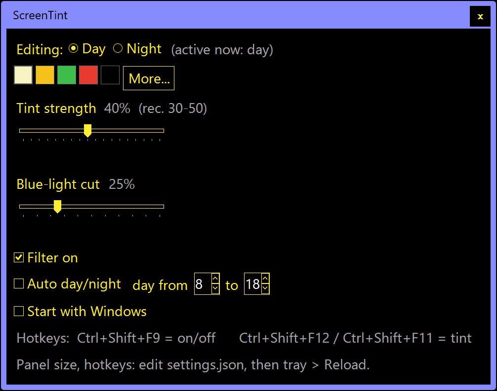

# ScreenTint (v2)

A personal full-screen color filter for Windows — deep tints, dimming, and real
blue-light reduction, in one readable file you own forever. No installer, no
accounts, no network access at all.



*The settings panel, shown here in high contrast. It can match Windows'
light/dark mode, stay dark or light, or switch by time of day — and scales
itself to your DPI and text size.*

## Why this exists

Screen color filters sit in an awkward spot: the best-known ones are
closed-source downloads you take on trust, and the smaller overlay tools tend
to live on download portals, app stores, or browser-extension galleries — where
hosting changes hands, maintainers drift away, and you can never quite tell
what an update actually did. That is the whole motivation here: a standalone
filter small enough to read in one sitting, kept as plain text in a folder you
control, with nothing between you and the code.

Two projects were the inspiration:

- [f.lux](https://sourceforge.net/app/f-lux/) — the original blue-light
  reducer, which established warming the display through the gamma table.
- [LightBulb](https://www.ghacks.net/2017/04/23/lightbulb-open-source-f-lux-alternative-for-windows/)
  — an open-source f.lux alternative for Windows, proof that the idea fits in
  a small, transparent tool.

## Two sliders, two different mechanisms

v2 exists because a veil alone isn't what "blue light filter" apps do:

- **Tint strength** is the veil: a translucent, click-through colored layer drawn
  over the screen. It *adds* color on top of everything — great for character
  (green, red, deep amber) and for dimming (the black swatch), but it also
  lightens blacks and only mutes blue indirectly.
- **Blue-light cut** works underneath instead: it rewrites the display's gamma
  table — the same mechanism Night Light and f.lux use — so the monitor simply
  *emits* less blue (and somewhat less green). Blacks stay black, contrast stays
  put, and blue genuinely goes down rather than being painted over.

Use them together: a modest tint for character, a strong blue cut for your eyes.
Each day/night profile stores both. The blue cut is fully restored when you exit,
toggle off, or the app closes for any reason it can catch.

## Setup

1. Put the files together in any folder you like (`settings.json` is created
   there on first run).
2. Double-click **Start ScreenTint.cmd**. A colored dot appears in the tray.
3. Click the dot: pick a swatch, set the two sliders, done.

**Upgrading from v1:** right-click the tray dot → Exit ScreenTint first (only one
copy runs at a time), then launch the new version. Your settings.json is kept and
gains the new options automatically. If you renamed the folder, the "Start with
Windows" entry re-heals itself on the next launch.

## Using it

- **Presets** cover the classic eye-comfort palette — pale yellow, yellow,
  green, red, and a dimming black; **More…** opens a full color picker.
- **Tint strength**: 30–50% is comfortable; capped at 85% so the screen can never
  go fully dark. **Blue-light cut**: 0–100%, as deep at 100% as Night Light's
  maximum warmth or a bit past it.
- **Day/Night**: two profiles; the radio buttons choose which one you're editing.
  Tick **Auto day/night** and set daytime hours to switch automatically.
- **Tray right-click**: on/off, **Reload settings.json**, **Reset display
  colors** (an escape hatch that pushes every monitor back to a clean baseline),
  and Exit.
- Settings live in `settings.json` beside the script — plain text.

## Hotkeys — yours to choose

Defaults: `Ctrl+Shift+F9` = on/off, `Ctrl+Shift+F12` / `Ctrl+Shift+F11` = tint
±5%. Since keyboards (and PowerToys remaps) differ, they're configurable — edit
the `hotkeys` section of settings.json:

```json
"hotkeys": { "toggle": "Ctrl+Shift+F9", "up": "Ctrl+Shift+F12", "down": "Ctrl+Shift+F11" }
```

Combine `Ctrl`, `Alt`, `Shift`, `Win` with one key: a letter or digit, `F1`–`F24`,
`Home`, `End`, `PgUp`, `PgDn`, `Up`, `Down`, `Left`, `Right`, `Space`, `Tab`,
`Ins`, `Del`, or `Pause`. `"none"` disables a hotkey. Save, then tray →
**Reload settings.json** — no restart needed. If a combo does nothing, something
else already owns it; pick another.

## Panel size

The panel now lays itself out to fit your DPI, Windows text-size setting, and
theme (including high contrast) — nothing should clip. To make the whole panel
bigger or smaller, set `panelFontSize` in settings.json (7–24, default 10.5) and
use tray → Reload.

## Panel theme

The *Panel theme* menu in the settings panel:

| Choice           | What the panel does                                        |
| ---------------- | ---------------------------------------------------------- |
| Match Windows    | follows Windows' light/dark app mode (the default)         |
| Always dark      | dark, whatever Windows is set to                           |
| Always light     | light, whatever Windows is set to                          |
| By time of day   | light during the *day from … to …* hours, dark otherwise   |

"By time of day" uses the same day hours as *Auto day/night* (whether or not
that box is ticked). Changes show live while the panel is open. With a Windows
high-contrast theme on, the panel always uses your high-contrast colors.

## Sharing the screen with other always-on-top apps

Windows keeps one pile of "always on top" windows, and whoever asserts last sits
highest — so other apps can shove the veil down, and around full-screen or
virtual-desktop changes Windows may stop drawing it ("cloaking"). A small guard
checks twice a second:

1. another app's window on top of the veil → the veil re-claims the top (and
   keeps its own settings panel above it, so the panel stays readable);
2. veil hidden or cloaked → it's re-shown — the automatic version of toggling
   *Filter on*;
3. still hidden after three tries → the veil is rebuilt as brand-new windows,
   which Windows always draws on the desktop you're looking at;
4. after sleep or lock → the veil is refreshed once.

Tray → **Bring the tint back** does step 2 on demand. The blue-light cut is
immune to all of this (it's not a window), and it's re-applied every 15 seconds
in case Night Light or a game rewrites the gamma table.

## For the skeptics: verify it yourself

`ScreenTint.ps1` is the entire program — what you read is exactly what runs:

- **It cannot see your screen.** Search the file for `CopyFromScreen`, `BitBlt`,
  or `PrintWindow` — the screen-reading APIs — and you'll find nothing. The
  gamma calls read and write the display's *color curve* (768 numbers), never
  pixels. The only mention of "capture" is the line that *excludes* the veil
  from screenshots.
- **It cannot touch the network.** Search for `http`, `web`, `socket`,
  `request`, `dns`, or `upload` — zero hits. Nowhere for data to go.
- **It cannot log your keys.** No keyboard hook (`SetWindowsHookEx` appears
  nowhere); `RegisterHotKey` asks Windows to deliver your three chosen
  shortcuts and nothing else.
- **It writes almost nothing.** `settings.json` beside the script, and — only if
  you tick the box — one autostart value under your own user's Run key, in the
  clearly-marked `Set-Autostart` function.
- **It needs no administrator rights** and shows up in Task Manager as an
  ordinary "Windows PowerShell" process.

## Nice touch: clean screenshots

The veil marks itself as excluded from capture (Windows 10 2004+), and gamma
changes generally don't reach captures either — so screenshots and screen-shares
show the clean, untinted screen.

## What it can't cover (honest limitations)

- **UAC prompts and the login screen** stay untinted — Windows draws those on a
  protected desktop no normal app can touch. (The blue-light cut *does* usually
  still apply there, since it lives in the display pipeline.)
- **Exclusive-fullscreen games** can bypass the veil and may reset gamma while
  running; borderless-windowed mode behaves. Gamma is re-applied within 15 s.
- **Night Light**: leave it off — otherwise the two take turns rewriting the
  same gamma table.
- **HDR mode** can mute both effects — Windows composites HDR differently.
- Windows caps how far gamma may bend without an unlock: at 100% the blue
  channel bottoms out at ×0.50. If you ever want *deeper*, there's a documented
  one-time tweak (the same one LightBulb uses): as administrator, add DWORD
  `GdiIcmGammaRange` = `0x100` under
  `HKLM\SOFTWARE\Microsoft\Windows NT\CurrentVersion\ICM`, sign out and back
  in, then lower `$BlueFloor` near the top of the script. Entirely optional.
- A console window flashes for about a second at launch — PowerShell starting
  up, minimized by the launcher.

## Uninstall

Untick **Start with Windows** if ticked, tray → **Exit ScreenTint** (this
restores your display's original colors), delete the folder. That's everything.
If colors ever look off after a crash, tray → **Reset display colors**, or
simply sign out and in — Windows rebuilds the gamma table at logon.

## Tweaks

Preset swatches: the `$Presets` list at the top of the script. Tint cap:
`$MaxIntensity`. Blue-light depth: `$BlueFloor` / `$GreenFloor` right below.
Everything else: settings.json + tray Reload.

## License

Copyright © 2026 esorhizome OÜ. Released under the
[Creative Commons Attribution 4.0 International](https://creativecommons.org/licenses/by/4.0/)
license (CC BY 4.0) — use, modify, and share freely, with attribution.
